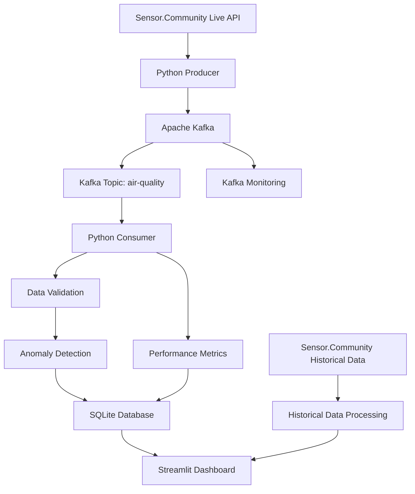

# AirWatch – Real-Time Air Quality Monitoring and Anomaly Detection Using Apache Kafka

## 1. Project Overview

**AirWatch** is a real-time air quality monitoring and anomaly detection system developed using Python, Apache Kafka, SQLite, and Streamlit.

The system collects real-world air quality measurements from the **Sensor.Community** platform, processes the incoming sensor data through an Apache Kafka streaming pipeline, identifies unusual pollution levels, stores the processed measurements in a database, and displays the results through an interactive dashboard.

The main objective is to monitor air pollution in selected German cities and provide information about current pollution conditions, historical pollution patterns, detected anomalies, and streaming performance.

The project focuses on the following six cities:

- Berlin
- Bremen
- Hamburg
- Hannover
- Kiel
- Munich

## 2. Project Objectives

The main objectives of AirWatch are:

1. Collect real-time air quality measurements from genuine environmental sensors.
2. Use Apache Kafka to handle continuous sensor data streams.
3. Validate incoming measurements before storing them.
4. Detect unusual PM2.5 and PM10 pollution values.
5. Store processed measurements and alerts in SQLite.
6. Display current air quality information through a Streamlit dashboard.
7. Compare current pollution conditions with historical measurements.
8. Evaluate streaming performance, including processing latency, delivery latency, and throughput.
9. Monitor Kafka consumer activity and message backlog.

## 3. System Architecture

AirWatch follows a producer–broker–consumer architecture.

### Architecture Diagram

### Architecture Components

**1. Sensor.Community API**

The system collects genuine air quality measurements from the Sensor.Community live data API.

The measurements include:

- PM10 concentration (P1)
- PM2.5 concentration (P2)
- Temperature, when available
- Humidity, when available
- Sensor identification
- Measurement timestamp
- Sensor location information

**2. Python Producer**

The producer retrieves measurements from the live API and prepares them for Kafka.

Responsibilities:

- Fetch sensor measurements periodically.
- Filter measurements belonging to the selected German sensors.
- Extract relevant measurement parameters.
- Prepare structured messages.
- Attach event identification and producer timestamps.
- Send messages to the Kafka topic.
- Track previously sent event IDs to reduce duplicate publishing.

**3. Apache Kafka**

Apache Kafka acts as the messaging and streaming layer.

The project uses:

- Kafka topic: `air-quality`
- Number of partitions: 3
- Bootstrap server: `localhost:9092`
- Message key: sensor ID
- Producer acknowledgement: `acks=all`

Kafka allows the producer and consumer to operate independently.

**4. Python Consumer**

The consumer reads messages from the Kafka topic.

Responsibilities:

- Receive incoming sensor measurements.
- Filter selected sensors.
- Validate message structure and measurement values.
- Check data quality.
- Identify unusual pollution measurements.
- Store measurements in SQLite.
- Record performance metrics.
- Commit Kafka offsets after processing.

**5. Data Validation**

The validation component checks incoming sensor data before it is accepted for processing.

Examples of validation checks include:

- Required fields are available.
- Sensor identification is valid.
- Measurement timestamps are usable.
- Supported measurement parameters are present.
- Measurement values are numeric.
- Values are checked for invalid or suspicious conditions.

**6. Anomaly Detection**

The anomaly detection component identifies unusually high PM2.5 and PM10 measurements.

Detected anomalies are stored in the database and displayed in the dashboard.

**7. SQLite Database**

SQLite provides persistent storage for the processed measurements and system information.

The database stores information such as:

- Sensor measurements
- Data quality results
- Pollution anomaly alerts
- Performance metrics

**8. Streamlit Dashboard**

The dashboard presents the processed information through an interactive web interface.

It provides real-time monitoring, historical comparisons, anomaly information, data quality information, and streaming performance statistics.

---

## 4. Technologies Used

| Technology | Purpose |
|---|---|
| Python | Main programming language |
| Apache Kafka | Real-time message streaming |
| Sensor.Community API | Real-world air quality measurements |
| SQLite | Data storage |
| Pandas | Data processing and analysis |
| Streamlit | Interactive dashboard |
| Plotly | Interactive charts and visualizations |
| Requests | API communication |
| kafka-python | Python integration with Kafka |

## 5. Data Sources

### 5.1 Real-Time Data

AirWatch uses the Sensor.Community live API:

https
